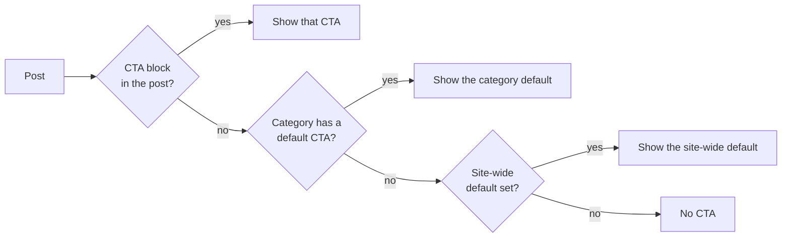

# Campaign CTAs

Reusable call-to-action banners for WordPress posts. Build a CTA once, place it in any post with a block, and change it in one place when the campaign changes. Posts without a CTA get the right one automatically, based on their category.

**[▶ Try it live in WordPress Playground](https://playground.wordpress.net/?blueprint-url=https://raw.githubusercontent.com/matteszk/acme-demo-site/main/blueprint.json)**: a full demo site in your browser, nothing to install.

https://github.com/user-attachments/assets/ebef6e82-b6fe-4d17-bc1d-dca6c4a90d7a

## Why

On a busy company blog, CTAs are usually banner images pasted into each post. They go stale the moment a campaign ends, and updating them means editing hundreds of posts by hand. Campaign CTAs treats a CTA as content instead: one CTA, used everywhere, updated once.

## How a post gets its CTA

Every post ends up with exactly one CTA, chosen in this order:

1. **Placed by hand.** A writer adds the CTA block to a post. This always wins.
2. **Category default.** Each category can have its own default CTA.
3. **Site-wide default.** Used for anything else.

For example, on the [demo site](https://playground.wordpress.net/?blueprint-url=https://raw.githubusercontent.com/matteszk/acme-demo-site/main/blueprint.json):

| Post | Category | CTA shown | Why |
|---|---|---|---|
| A checklist for automating data cleanup | Guides | 2026 State of Data report | Placed in the post by hand |
| How to pick the right chart | Guides | Start a free trial | Guides default |
| Introducing Acme 4.0 | Product Updates | Launch webinar | Product Updates default |
| We are opening a Lisbon office | Company News | Newsletter | No category default, so the site-wide default |

Edit the "free trial" CTA once and every Guides post shows the new version.

## Features

- **CTAs as content.** Each CTA has a heading, body text, a button and an optional image (its featured image), plus a color theme: dark, light or brand.
- **A CTA block** with a dropdown picker and a live preview in the editor.
- **One source of truth.** Posts store only the CTA's ID, and the block renders on each page view, so edits show up everywhere straight away.
- **Automatic fallbacks** by category, or any other taxonomy you choose, then a site-wide default.
- **No dependencies.** Native post meta, no ACF, no build step.

## Getting started

1. Install and activate the plugin.
2. Go to **CTAs → Add New**, fill in the content and publish.
3. In a post, add the **CTA** block and choose a CTA.
4. To set up fallbacks, go to **CTAs → Settings** and choose a site-wide default and the taxonomy used for fallbacks (Categories by default). Then open a category under **Posts → Categories** and set its **Default CTA**.

## For developers

| What | Where |
|---|---|
| Post type | `ccta_cta` |
| CTA fields (post meta) | `ccta_heading`, `ccta_body`, `ccta_button_text`, `ccta_button_url`, `ccta_theme` |
| Category default (term meta) | `ccta_default_cta` |
| Site-wide settings (options) | `ccta_default_cta`, `ccta_taxonomy` |
| Block | `campaign-ctas/cta`, dynamic, attribute `ctaId` |

Fallback CTAs are added to the end of single posts through the `the_content` filter, and only when the post has no CTA block.

**Styling.** The markup uses BEM-style classes, so a theme can restyle it without touching the plugin: `.ccta`, `.ccta--dark` / `.ccta--light` / `.ccta--brand`, `.ccta__image`, `.ccta__heading`, `.ccta__body` and `.ccta__button`. The brand theme uses your theme's `primary` color when it has one.

## Known limitations

- When a post has several categories with defaults, the first one alphabetically wins. There's no "primary category" support yet.
- Fallbacks apply to posts only, not pages or custom post types.

## Background

I originally built this for a large corporate blog, where it replaced one-off banner images that kept going stale. This is a from-scratch rebuild as a standalone plugin, moving from a TinyMCE shortcode to a block and from ACF to native post meta.

## Requirements

WordPress 6.1+ and PHP 7.4+.

## License

GPL-2.0-or-later
